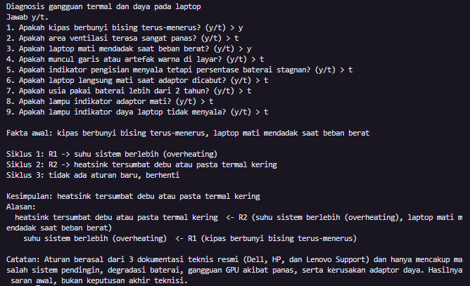
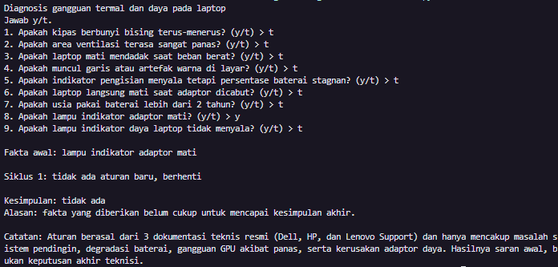
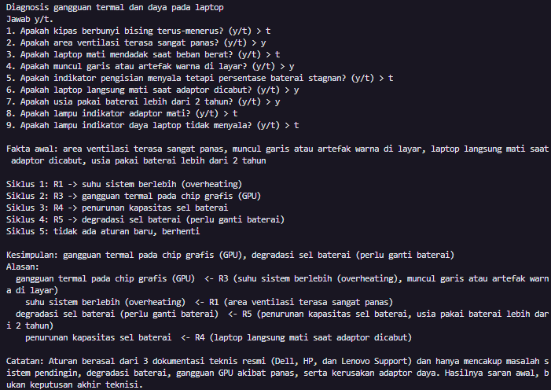

# Sistem Pakar Sederhana: Diagnosis Gangguan Termal dan Daya pada Laptop

Tugas 5 Mata Kuliah Kecerdasan Buatan (Materi 5: Membuat Sistem Pakar Sederhana)

## 1. Identitas Mahasiswa

- **Nama**: Muhammad Akbar
- **NIM**: F1D02410075
- **Kelas**: Kecerdasan Buatan - Kelas 5C

## 2. Topik dan Cara Menjalankan Program

- **Topik**: Diagnosis gangguan termal (sistem pendingin & GPU) serta masalah daya (baterai & adaptor) pada perangkat laptop.
- **Bahasa Pemrograman**: Python 3.14+ (diuji pada versi 3.14.3)
- **Cara Menjalankan Program**:
  1. Pastikan file `main.py` dan `kb_laptop.json` berada di dalam satu folder yang sama.
  2. Buka terminal / Command Prompt pada direktori tersebut.
  3. Jalankan perintah berikut:
     ```bash
     python main.py
     ```
  4. Jawab setiap pertanyaan gejala dengan mengetik `y` (ya) atau `t` (tidak) lalu tekan Enter.

## 3. Daftar Sumber dan Tabel Aturan

### Daftar Sumber Pengetahuan

- **S1**: _How to Troubleshoot Overheating, Shutdown, or Thermal Issue on a Dell PC_, Dell Technologies Support, https://www.dell.com/support/kbdoc/en-us/000126090, diakses 13 Nov 2026.
- **S2**: _HP Notebook PCs - Testing and calibrating the battery_, HP Customer Support, https://support.hp.com/us-en/document/ish_2025929-1929258-16, diakses 13 Nov 2026.
- **S3**: _Troubleshooting No Power Issues on ThinkPad Notebooks_, Lenovo Support, https://support.lenovo.com/us/en/solutions/ht509520, diakses 13 Nov 2026.

### Tabel Aturan IF-THEN

| Aturan | IF                                                                                                                | THEN                                                  | Sumber |
| :----- | :---------------------------------------------------------------------------------------------------------------- | :---------------------------------------------------- | :----- |
| **R1** | IF kipas berbunyi bising terus-menerus **OR** area ventilasi terasa sangat panas                                  | THEN suhu sistem berlebih (overheating)               | S1     |
| **R2** | IF suhu sistem berlebih (overheating) **AND** laptop mati mendadak saat beban berat                               | THEN heatsink tersumbat debu atau pasta termal kering | S1     |
| **R3** | IF suhu sistem berlebih (overheating) **AND** muncul garis atau artefak warna di layar                            | THEN gangguan termal pada chip grafis (GPU)           | S1     |
| **R4** | IF indikator pengisian menyala tetapi persentase baterai stagnan **OR** laptop langsung mati saat adaptor dicabut | THEN penurunan kapasitas sel baterai                  | S2     |
| **R5** | IF penurunan kapasitas sel baterai **AND** usia pakai baterai lebih dari 2 tahun                                  | THEN degradasi sel baterai (perlu ganti baterai)      | S2     |
| **R6** | IF lampu indikator adaptor mati **AND** lampu indikator daya laptop tidak menyala                                 | THEN kerusakan adaptor daya (AC adapter)              | S3     |

_Keterangan Rantai Aturan_: Hasil dari **R1** (`suhu sistem berlebih (overheating)`) dipakai sebagai syarat pada **R2** dan **R3**. Hasil dari **R4** (`penurunan kapasitas sel baterai`) dipakai sebagai syarat pada **R5**.

## 4. Metode yang Dipilih dan Alasannya

- **Metode**: **Forward Chaining (FC)**
- **Alasan Pemilihan**: Dalam kasus diagnosis kerusakan perangkat keras laptop, pengguna umumnya hanya mengetahui gejala-gejala fisik awal yang terlihat atau dirasakan (seperti kipas berisik, bodi panas, atau lampu indikator mati) tanpa mengetahui hipotesis komponen mana yang rusak terlebih dahulu. Pendekatan _Forward Chaining_ bekerja secara _data-driven_ (bergerak maju dari fakta-fakta gejala awal menuju kesimpulan akhir), sehingga mampu mengevaluasi seluruh kemungkinan aturan yang cocok secara otomatis dan menemukan satu atau lebih kesimpulan kerusakan sekaligus beserta jejak alasannya.

## 5. Tiga Kasus Uji dan Screenshot

| #     | Jawaban "ya"                                                                                                                                                   | Kesimpulan yang diharapkan                                                          |
| :---- | :------------------------------------------------------------------------------------------------------------------------------------------------------------- | :---------------------------------------------------------------------------------- |
| **1** | kipas berbunyi bising terus-menerus, laptop mati mendadak saat beban berat                                                                                     | heatsink tersumbat debu atau pasta termal kering                                    |
| **2** | lampu indikator adaptor mati saja                                                                                                                              | **tidak ada** (kasus negatif)                                                       |
| **3** | area ventilasi terasa sangat panas, muncul garis atau artefak warna di layar, laptop langsung mati saat adaptor dicabut, usia pakai baterai lebih dari 2 tahun | gangguan termal pada chip grafis (GPU), degradasi sel baterai (perlu ganti baterai) |

### Screenshot Hasil Uji Program

**Kasus Uji 1 (Menghasilkan 1 Kesimpulan Berantai):**


**Kasus Uji 2 (Kasus Negatif / Tidak Menghasilkan Kesimpulan):**


**Kasus Uji 3 (Menghasilkan 2 Kesimpulan Berantai):**


## 6. Batas Keberlakuan

Basis pengetahuan pada sistem pakar ini disusun berdasarkan 3 artikel panduan pemecahan masalah (_troubleshooting_) resmi dari Dell Technologies Support, HP Customer Support, dan Lenovo Support. Aturan yang dibuat hanya berlaku untuk indikasi awal gangguan termal (kipas pendingin, _heatsink_, pasta termal, dan efek panas pada GPU) serta masalah kelistrikan dasar (degradasi sel baterai _lithium-ion_ dan kerusakan _AC adapter_) pada laptop konsumen standar. Hasil yang dikeluarkan oleh program ini merupakan **saran diagnosis awal**, bukan keputusan akhir, dan tetap memerlukan pemeriksaan fisik menggunakan alat ukur (_multimeter_ atau _diagnostic tools_) oleh teknisi perangkat keras.

## 7. Penggunaan Alat Bantu AI

Dalam pengerjaan tugas ini, alat bantu AI (Google Gemini) digunakan sebagai asisten diskusi untuk menyusun kerangka penulisan kode pelacakan (_trace_) rekursif pada Python dan merapikan format tabel dokumentasi Markdown pada `README.md`. Seluruh logika aturan IF-THEN, pemilihan sumber referensi, dan pengujian kasus uji telah diverifikasi serta dipahami sepenuhnya oleh penulis.
